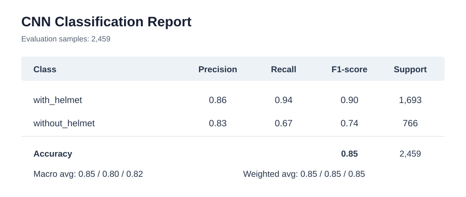
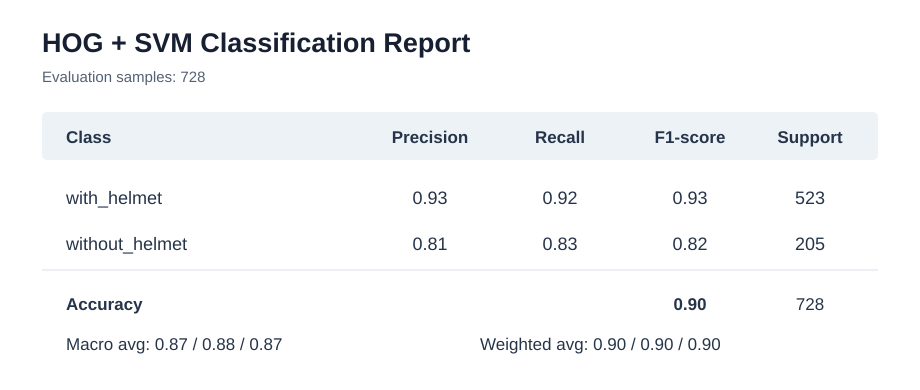

# CNN-Based Safety Helmet Detection

A computer-vision project exploring automated safety-helmet classification in construction-site imagery. The work compares a Convolutional Neural Network (CNN) with a classical Histogram of Oriented Gradients (HOG) + Support Vector Machine (SVM) pipeline, and includes a frame-by-frame video inference workflow.

> **Evaluation note:** This README presents the latest classification-report results supplied for the CNN and SVM experiments. The models were evaluated on different sample counts (2,459 for CNN and 728 for SVM), so the figures are useful for describing each experiment but do not constitute a strictly controlled head-to-head benchmark. Re-run both pipelines on the same held-out test set for a directly comparable evaluation.

## Problem statement

Workers in construction and industrial environments are expected to wear appropriate personal protective equipment. Manually checking helmet compliance across images or video is time-consuming. This project investigates whether image-classification models can distinguish between:
- **With helmet**
- **Without helmet**

The system is a prototype for visual safety monitoring. It is not a certified safety system and should not replace human supervision.

## Dataset

The Colab notebook reports the following directory-based dataset:

| Split / class | Images |
|---|---:|
| Training set (total) | 3,640 |
| Validation set (total) | 2,459 |
| Classes | 2 |

Class labels used in the notebook:
- `with helmet` → `0`
- `without helmet` → `1`

Images are loaded from class-specific folders using Keras `ImageDataGenerator`. The notebook resizes images to **128 × 128** pixels and rescales pixel values by `1/255`. Augmentation experiments include horizontal flipping, zoom, rotation, width/height shifts and shear. The notebook uses Google Drive paths, so the original dataset itself is not included in this repository.

**Dataset source:** The original notebook refers to a local Google Drive folder named `helmet detection`; it does not record a definitive public dataset URL. Add the exact dataset source/licence here before redistributing or claiming a specific public dataset.

Expected directory layout:

```text
helmet detection/
├── train/
│   ├── with helmet/
│   └── without helmet/
└── valid/
    ├── with helmet/
    └── without helmet/
```

## Methods

### 1. Convolutional Neural Network (CNN)

The notebook experiments with a sequential CNN for binary image classification. The documented architecture includes convolutional blocks with ReLU activations, max-pooling, dropout, a dense layer and a sigmoid output. The input shape is `128 × 128 × 3`.

Training experiments include:
- Adam optimiser (learning rate `0.001` in one training run)
- Binary focal loss (`alpha=0.75`, `gamma=2.0`) in one experiment
- Accuracy and AUC metrics
- Early stopping on validation loss, with patience of 7 and restoration of best weights

### 2. HOG + Support Vector Machine (SVM)

The classical pipeline:
1. Reads each image using OpenCV.
2. Resizes it to `128 × 128`.
3. Converts it to grayscale.
4. Extracts Histogram of Oriented Gradients (HOG) features using 9 orientations, `8 × 8` pixels per cell, `2 × 2` cells per block and `L2-Hys` normalisation.
5. Trains a linear SVM (`kernel='linear'`, `C=1.0`).

The notebook uses a stratified 80/20 train/test split with `random_state=42` for this SVM experiment.

### 3. Video inference

The video notebook loads a saved Keras model and processes an input video frame by frame. Each frame is resized and normalised, predictions are smoothed using a rolling queue of 8 predictions, and an on-frame HUD displays a `HELMET` or `NO-HELMET` label and confidence value. The threshold in the notebook is `0.30`.

The video notebook's saved model path is named `helmetdetect_SVM_Model.keras`, although the inference code loads it as a Keras model and sends it RGB image tensors. The filename alone does not establish whether the saved model is a CNN or another Keras-compatible model. Confirm the model architecture and training provenance before describing this video pipeline as SVM inference.

## Results

### CNN classification report

The updated CNN evaluation achieved **85% accuracy** across 2,459 validation/evaluation images.

| Class | Precision | Recall | F1-score | Support |
|---|---:|---:|---:|---:|
| With helmet | 0.86 | 0.94 | 0.90 | 1,693 |
| Without helmet | 0.83 | 0.67 | 0.74 | 766 |
| **Accuracy** |  |  | **0.85** | **2,459** |
| Macro average | 0.85 | 0.80 | 0.82 | 2,459 |
| Weighted average | 0.85 | 0.85 | 0.85 | 2,459 |



The CNN achieved a recall of **0.94** for the `with_helmet` class. Its recall for `without_helmet` was **0.67**, indicating that some images of people without helmets were not identified by this model.

### HOG + SVM classification report

The updated HOG + SVM evaluation achieved **90% accuracy** across 728 test images (the notebook's unrounded accuracy is approximately **89.56%**).

| Class | Precision | Recall | F1-score | Support |
|---|---:|---:|---:|---:|
| With helmet | 0.93 | 0.92 | 0.93 | 523 |
| Without helmet | 0.81 | 0.83 | 0.82 | 205 |
| **Accuracy** |  |  | **0.90** | **728** |
| Macro average | 0.87 | 0.88 | 0.87 | 728 |
| Weighted average | 0.90 | 0.90 | 0.90 | 728 |



The SVM achieved a recall of **0.83** for the `without_helmet` class, compared with 0.67 for the CNN in its supplied evaluation report.

### Model comparison and interpretation

| Evaluation metric | CNN | HOG + SVM |
|---|---:|---:|
| Accuracy | 85% | **90%** |
| Weighted precision | 0.85 | **0.90** |
| Weighted recall | 0.85 | **0.90** |
| Weighted F1-score | 0.85 | **0.90** |
| Recall — with helmet | **0.94** | 0.92 |
| Recall — without helmet | 0.67 | **0.83** |
| Evaluation samples | 2,459 | 728 |

Based on these reported experiments, HOG + SVM achieved the higher overall accuracy and weighted F1-score. It also achieved stronger recall for the `without_helmet` class. The CNN achieved slightly higher recall for the `with_helmet` class.

**Important comparison limitation:** The CNN report covers 2,459 samples, while the SVM report covers 728 samples. The datasets/splits are therefore not identical. The results should not be interpreted as a definitive controlled model comparison until both models are evaluated on the same held-out examples using consistent preprocessing and class ordering.

## Representative outputs

### CNN classification report


### HOG + SVM classification report


## Repository contents

```text
.
├── README.md
├── CNN_video_helmet_detect.ipynb
├── cnnhelmetdetect.ipynb
├── notebooks/
│   ├── helmet_detection_experiments.ipynb
│   └── video_helmet_detection.ipynb
├── results/
│   ├── cnn_classification_report.svg
│   └── svm_classification_report.svg
└── requirements.txt
```

## Environment and dependencies

The notebooks were developed in Google Colab. The video notebook records these pinned versions:
- Python 3 runtime supplied by Colab (exact minor version not recorded in the notebook)
- TensorFlow 2.17.0
- NumPy 1.26.4
- SciPy 1.12.0
- OpenCV 4.8.1

The image/SVM notebook also imports scikit-learn, scikit-image, Matplotlib, Seaborn and pandas. Exact versions for these packages are not recorded.

## Running the notebooks

1. Open a notebook in Google Colab.
2. Upload or mount the dataset in Google Drive using the directory layout above.
3. Update the dataset paths in the notebook to match your Drive.
4. Run cells in order.
5. For video inference, upload the trained Keras model and source video, then update `MODEL_PATH`, `IN_PATH` and `OUT_PATH`.

The notebooks currently contain Google Drive-specific paths and experimental/legacy cells; they are not yet plug-and-play from a fresh local clone.

## Limitations and future work

- Evaluate CNN and HOG + SVM on the same held-out test split.
- Consolidate the notebook into one definitive CNN training and evaluation pipeline.
- Record the exact dataset citation, version and licence.
- Save the final model with a clear architecture-specific filename and document its provenance.
- Generate confusion matrices from the same reproducible evaluation runs as the classification reports.
- Test across different lighting, camera angles, occlusion and construction-site conditions.
- Extend from image-level classification to person detection and helmet localisation if required.
- Consider deployment only after broader validation and safety review.

## Acknowledgements

Developed as an academic computer-vision project exploring deep learning and classical machine-learning approaches to safety helmet classification.
